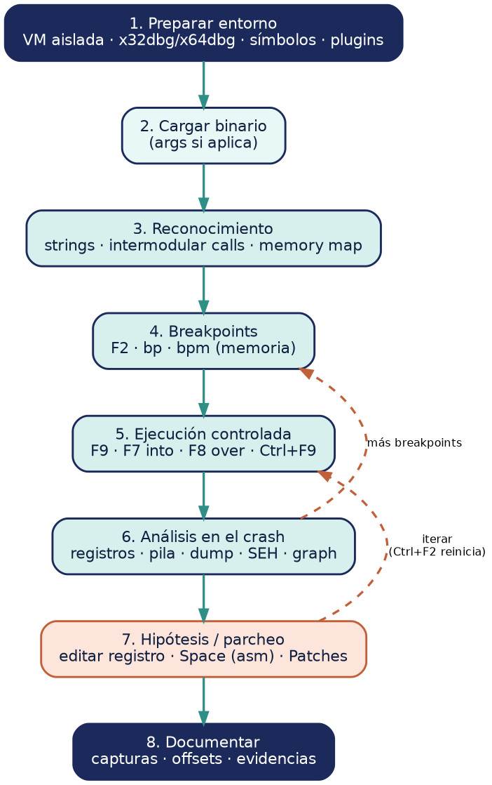

# 02 — Flujo de trabajo con x64dbg

Cómo se usa x64dbg de principio a fin en un análisis, desde que cargas el binario hasta que
sacas una conclusión. El flujo es **iterativo**: muchas veces vuelves atrás a poner más
breakpoints o a reejecutar.

*(La fuente editable del diagrama, en Graphviz y Mermaid, está en [`../assets/diagramas/`](../assets/diagramas/).)*

---

## 1. Preparación del entorno

- Trabaja **siempre en una VM aislada** (sobre todo con malware): snapshot limpio y red
  *host-only* o desactivada.
- Elige el ejecutable correcto: **x32dbg** para binarios de 32 bits, **x64dbg** para 64 bits.
- Configura **símbolos** (*Options → Preferences → Symbols*) para resolver nombres de APIs.
- Instala los plugins que vayas a necesitar (ScyllaHide si hay anti-debug, ERC si vas a hacer
  exploiting).

---

## 2. Carga del binario

- *File → Open* y selecciona el ejecutable (o arrástralo).
- Por defecto, x64dbg se detiene en el **EntryPoint** (o en el *system breakpoint* según
  configuración). Desde aquí ya puedes empezar a explorar.
- Si necesitas pasar **argumentos**, configúralos en *File → Change Command Line*.

---

## 3. Reconocimiento inicial (estático-dinámico)

Antes de ejecutar a ciegas, orienta el análisis:

- **Strings** y **Intermodular calls** (*Search for…*) para ver pistas: mensajes, nombres de
  APIs sospechosas (`VirtualAlloc`, `WriteProcessMemory`, `CreateRemoteThread`, `strcpy`…).
- **Memory Map** (`Alt+M`) para entender las regiones y permisos.
- Si tienes análisis estático previo en Ghidra/IDA, trae aquí las direcciones de interés.

---

## 4. Colocación de breakpoints

- `F2` sobre las instrucciones clave, o `bp <símbolo>` en APIs relevantes.
- Para corrupción de memoria: **breakpoint de memoria** (`bpm`) sobre la zona que te interesa
  vigilar (p. ej. la dirección de retorno en la pila).
- Breakpoints **condicionales** cuando una API se llama muchas veces y solo te importa un caso.

---

## 5. Ejecución controlada

- `F9` para correr hasta el primer breakpoint/excepción.
- A partir de ahí, avanza con **`F7` (into)** y **`F8` (over)**, y usa **`Ctrl+F9`** para salir
  de funciones que no te interesan.
- Observa en todo momento los 4 paneles: **disassembly**, **registros**, **dump** y **pila**.

---

## 6. Análisis en el punto de interés (o en el crash)

Cuando saltas al breakpoint o el programa casca:

- Lee el **estado de los registros**: ¿controlo `EIP`/`RIP`? ¿qué valores hay en `ESP/RSP`,
  `EAX/RAX`, etc.?
- Inspecciona la **pila** (`dump esp`) y el **dump** de memoria para ver **dónde acabó tu
  entrada**.
- Mira la **ventana SEH** si el fallo pasa por manejo de excepciones.
- Usa el **Graph** (`G`) para entender el flujo de la función.

---

## 7. Hipótesis, prueba y (si aplica) parcheo

- Formula una hipótesis ("si controlo X, puedo redirigir a Y") y **pruébala**: modifica un
  registro o un byte (`Space` para ensamblar) y vuelve a ejecutar.
- Si el objetivo es neutralizar un chequeo en un análisis de laboratorio, **parchea** la
  instrucción y exporta con *Patches* (`Ctrl+P`).
- Itera: casi nunca sale a la primera. Reinicia (`Ctrl+F2`) y repite con el ajuste nuevo.

---

## 8. Documentación

- Anota direcciones, offsets, valores de registros y la secuencia de pasos.
- Captura las pantallas clave (estado del crash, EIP controlado, breakpoint de memoria).
- Exporta el binario parcheado o el volcado de memoria si forman parte de la evidencia.

> **La clave del flujo:** x64dbg no "resuelve" el análisis solo; te da **observabilidad** en
> tiempo real. El valor lo pones tú al interpretar registros, pila y memoria para pasar de "se
> rompe" a "entiendo por qué y cómo".

---

## Variante: flujo para desarrollo de exploits (laboratorio)

1. Cargar el binario vulnerable en x32dbg/x64dbg.
2. Enviar un **patrón cíclico** como entrada (ERC: `!pattern_create <n>`).
3. Provocar el crash y **leer `EIP`/`RIP`**.
4. Calcular el **offset** (ERC: `!pattern_offset <valor>`).
5. Buscar un **`jmp esp`** / gadget fiable (`findasm "jmp esp"` o ERC).
6. Construir una **PoC de control** (en laboratorio basta con lanzar `calc.exe` o un mensaje).

> Este sub-flujo es exactamente el que se aplica en [`04-caso-practico.md`](04-caso-practico.md)
> sobre el binario vulnerable del laboratorio.
